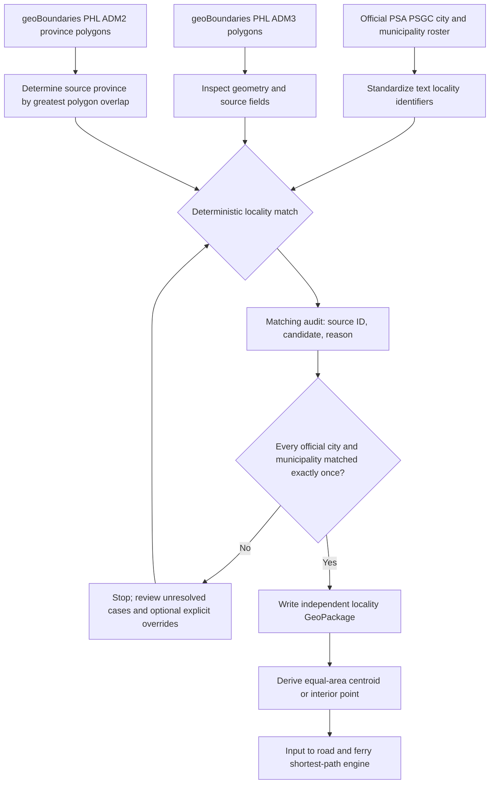

# Independently generating Philippine municipal boundaries

The project independently obtains and reconciles Philippine municipal polygons from the **Philippine Statistics Authority PSGC** and **geoBoundaries ADM3/ADM2** datasets. It does not need a previously constructed national area catalog or an existing project's packaged GeoPackage.

## Method overview

The reproducible preparation pipeline is:



Administrative boundaries and the *road/ferry transport network* are prepared independently. See [transport extraction](transport.md) and [input data](inputs.md).

## Upstream sources and their different dates

1. **PSA PSGC:** Official locality codes and names. By default the new builder attempts to fetch the [PSGC Q2 2026 publication workbook](https://psa.gov.ph/system/files/scd/PSGC-2Q-2026-Publication-Datafile.xlsx), linked from [PSA's Q2 announcement](https://psa.gov.ph/content/second-quarter-2026-psgc-updates-renaming-one-municipality-and-one-barangay-and-correction). The selected official roster contains **1,493 municipalities and 149 cities**.
2. **geoBoundaries ADM3:** Municipality/city polygons from the [PHL/ADM3 metadata endpoint](https://www.geoboundaries.org/api/current/gbOpen/PHL/ADM3/). At the time of writing its current API reports **1,647 source units** and `boundaryYearRepresented: 2020`, so its geometry vintage **does not match** the 2026 PSGC roster. The builder retrieves the **simplified** geometry URL from the API metadata.
3. **geoBoundaries ADM2:** Province polygons from [PHL/ADM2](https://www.geoboundaries.org/api/current/gbOpen/PHL/ADM2/), used only to disambiguate repeated locality names. If a source boundary lacks an explicit province field, the builder assigns a *candidate* province using the largest area of overlap with an ADM2 polygon.

**Licensing caution:** the PHL ADM3 API metadata identifies a source license of **CC BY 3.0 IGO**, while geoBoundaries' general gbOpen material discusses CC BY 4.0/ODbL. Consult the **dataset-specific metadata** before redistributing generated boundaries; do not assume the general gbOpen license supersedes it. The metadata, source hashes and source URLs are captured in the build provenance file.

## Build from upstream

```bash
python -m pip install -e ".[geo]"
python scripts/build_boundaries.py --output data
```

This command attempts to download the pinned PSA Q2 2026 XLSX and discover current geoBoundaries ADM3/ADM2 geometries, then reconcile them. It **may stop for manual review**: it is neither reasonable nor safe to pretend that two vintages match perfectly by name or feature order. Network access is required on first download.

**Reproducible pinned runs:** the PSA workbook URL is pinned to Q2 2026 (the URL, not the file content: the provenance file records the SHA-256 of what was actually downloaded), but geoBoundaries' `/current/` metadata is *moving*. The first run saves the downloaded geometry files in `data/sources/` together with the API metadata that describes them (`geoboundaries_phl_adm3_metadata.json`, `..._adm2_metadata.json`); later runs reuse both without contacting the API, and the provenance file records their SHA-256 hashes. For publication-quality replication, archive those files securely and supply them again using `--adm3` and `--adm2`. The tool does not overwrite cached downloads automatically.

### Use explicit local upstream snapshots

```bash
python scripts/build_boundaries.py \
  --psgc data/sources/psgc_q2_2026_publication_datafile.xlsx \
  --adm3 data/sources/geoboundaries_phl_adm3_simplified.geojson \
  --adm2 data/sources/geoboundaries_phl_adm2_simplified.geojson \
  --output data
```

For a custom PSA table, export a CSV containing `psgc_code,name,kind,province` with **PSGC codes as text**. `kind` must be `city` or `municipality`. An official workbook's worksheet/header layout can differ from release to release; the loader detects common headers and otherwise stops with a clear error instead of guessing.

### Reconciling records

The script chooses candidates in this order:

1. A **reviewed override** keyed by stable boundary `shapeID` or equivalent.
2. An identifiable source locality code (ten-digit PSGC or `PH` + seven historical digits), **with a name consistency check**.
3. An exact **normalized name and province** match, if province evidence exists.
4. An exact **normalized national name**, only if the name is unique among current PSGC localities.

No fuzzy automatic matches and no row-position joins are permitted. Duplicate assignments, unmatched official localities, source name conflicts, and ambiguous candidates are recorded in the audit CSV. A completed GeoPackage is **not produced** unless all official localities are matched exactly once and unresolved source cases have been resolved.

An incomplete reconciliation writes its audit and provenance to `data/boundary_build_incomplete/` and never changes the selected release. A complete build stages the GeoPackage, point shapefile and *all* sidecars, audit, and provenance in a private directory before atomically publishing a single `current_boundaries.json` pointer. If point generation fails, the previously selected release remains intact. A new release requires `--replace` when an existing release is already selected, and older releases are retained for reproducibility.

After reviewing source-only extra polygons from older boundary vintages, you can explicitly permit them to remain excluded:

```bash
python scripts/build_boundaries.py --output data --allow-extra-boundaries
```

This does **not** waive the requirement to match all current PSGC cities and municipalities once. It only allows unmatched source polygons to remain as documented exceptions in the audit.

For ambiguous/mismatched polygon records, create `reviewed_overrides.csv`:

```csv
boundary_id,psgc_code
SOURCE-SHAPE-ID-TO-VERIFY,0100101000
```

The source ID above is a **placeholder**, not a real match. Replace it with the exact stable ID from the audit **only after checking the map and official identity**. Rerun with `--overrides reviewed_overrides.csv`. Never invent rows in the crosswalk solely to satisfy a target count.

## Outputs

| Output | Meaning |
| --- | --- |
| `data/current_boundaries.json` | Atomic pointer to the selected, complete boundary release |
| `data/boundary_releases/<release-id>/municipality_boundaries.gpkg` | Reconciled WGS84 polygons (`areas` layer) |
| `data/boundary_releases/<release-id>/muncity_centroids.shp` plus sidecars | Locality origin points for the routing pipeline |
| `data/boundary_releases/<release-id>/boundary_match_audit.csv` | Every matching decision and exception |
| `data/boundary_releases/<release-id>/boundary_provenance.json` | Source paths/hashes, versions, counts, output hashes |
| `data/boundary_build_incomplete/` | Audit and provenance of the latest *incomplete reconciliation* |
| `data/sources/` | Downloaded upstream snapshots and metadata (excluded from git) |

The builder's default is an area-weighted centroid in EPSG:6933, transformed to WGS84. Such a centroid may fall offshore or outside a multipart polygon. If an interior point is preferred, use `--point-method representative-point`. Neither represents population, municipal-hall location, actual travel demand, or observed journeys.

A separately provided polygon layer can also be converted using `scripts/centroids_from_boundaries.py` (run it with `--help`), but the *new preferred workflow is `build_boundaries.py`*, which reconstructs source geometry and keys independently.

## Identifier warning

The original saved matrix has historical identifiers like `PH0102801`. The PSA roster uses ten-digit codes such as `0102801000`. Although the seven-digit historical pattern may suggest a candidate for some localities, it **is not a guaranteed crosswalk** across administrative reorganizations. The converter validates candidate IDs against the selected roster and requires review on conflicting names. A freshly generated set of municipality points requires a **new** matrix run and a new stable row/column order.

## Boundaries versus road-network generation

The geographical inputs are two different projects within the pipeline:

- **Locality polygon construction**: PSA + geoBoundaries → polygons → origin points. Now independently implemented here.
- **Routing network construction**: independently extracted or supplied road/ferry shapefiles → weighted graph → shortest-path matrix.

Generating locality polygons alone **does not supply** roads or ferries. Run the separate [OpenStreetMap transport builder](transport.md) or provide independently prepared and verified shapefiles.

## Validation boundary

The matcher and synthetic end-to-end GeoPackage/point workflow are covered by automated tests. **A full live national upstream download, official XLSX sheet inspection, and 1,642-feature reconciliation have not yet been demonstrated.** The script is deliberately designed to stop with actionable audit output rather than claim a successful full national build without this verification.
