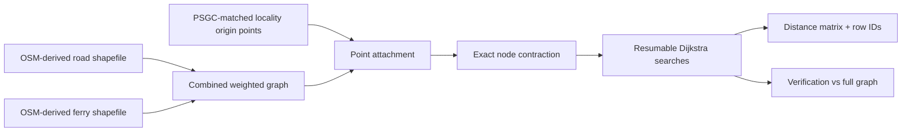

# net-distance-ph

## Distances across an archipelago, without pretending the sea is a road

`net-distance-ph` computes **shortest-path distance, in kilometres, between
Philippine city and municipality reference points** through a combined network
of road polylines and mapped ferry routes. It is a batch research pipeline,
not a navigation application, travel-time predictor, or official dataset.

The original completed run covered **1,642 localities** and generated a
`1,642 × 1,642` matrix. Those counts refer to its particular source vintage;
new PSGC rosters and new geometry versions may differ. The GitHub repository
contains **code and synthetic tests**, not the original national datasets.

!!! info "In one sentence"
    The distance from locality A to locality B is the sum of the minimum
    traversable road/ferry edge lengths between their attached network nodes,
    plus (by default) their geometric centroid-to-network connectors.

### What it produces

| Deliverable | Meaning |
| --- | --- |
| `distance_matrix_km.npy` | Numerical float64 matrix; `inf` for absent or not-yet-resolved distances |
| `distance_matrix_km.csv` | Human-readable distances, labelled with original locality IDs |
| `towns.csv` | Exact row order, IDs, names, points and snapping diagnostics |
| `row_validity_radius_km.npy` | How far each row's computation is complete |
| `matrix_report.json` | Completion, reachability and symmetry diagnostics |
| `source_manifest.json` | Input shapefile SHA-256 hashes, geometry settings, and core identity |
| `verification.txt` | Physical and numerical cross-checks |

### What makes it different from a straight-line distance matrix?

A geodesic distance ignores road detours and island crossings. This pipeline
traces geometry on the **connected graph**, making the resulting quantity
network distance. On the other hand, it does not know travel times,
road restrictions, schedules, traffic or whether a ferry actually operates.

### Documentation guide

- [Getting started](getting-started.md) — install, inspect, calculate.
- [Inputs and identifiers](inputs.md) — required schemas, CRS and PSGC caution.
- [Methodology](methodology.md) — exact graph construction and algorithms.
- [Pipeline](pipeline.md) — stages, flags and crash recovery.
- [Outputs](outputs.md) — safe use of matrix cells and partial results.
- [Validation](validation.md) — tests, verification and known limitations.
- [Independent boundary generation](boundaries.md) — official upstream sources, polygon matching, audit, and representative points.
- [Independent road and ferry extraction](transport.md) — OSM PBF downloads, tag rules, ferry relations, and source auditing.
- [Reproducibility](reproducibility.md) — snapshots, citations and publication.
- [FAQ](faq.md) — common interpretation questions.

### Intended users

Researchers studying regional accessibility, spatial interaction, network
proximity and geographic frictions; analysts who need consistent spatial
weights based on a network, rather than Euclidean distance; and GIS engineers
who want an auditable national matrix. It is still the researcher's duty to
justify whether geometric centroid travel distance measures the relevant
spatial process.

!!! warning "No precomputed distance claims"
    The documentation describes algorithms and a historical completed run.
    The actual dataset, source-date accuracy and ferry coverage of any **new**
    national calculation depend on the GIS files that you supply.
