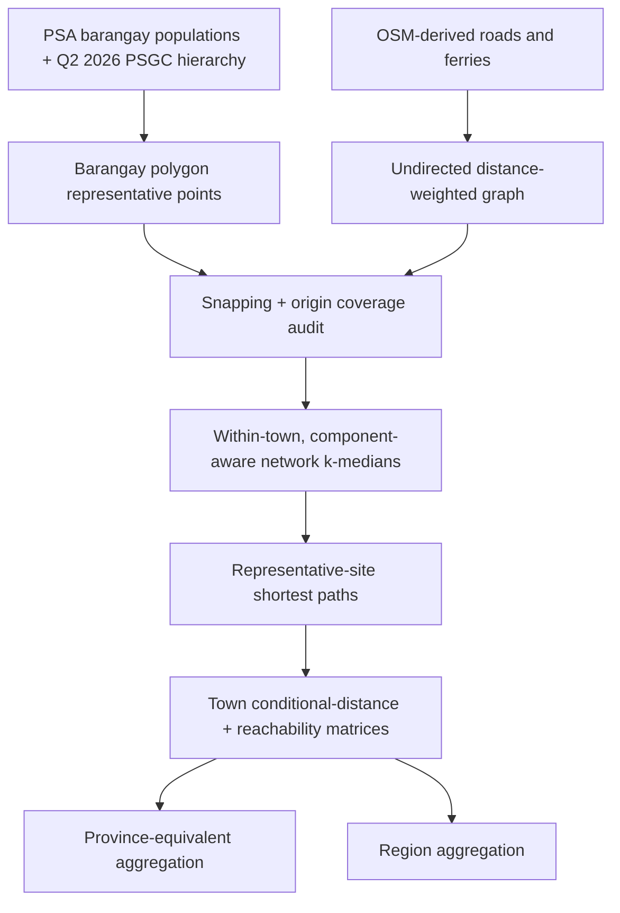

<!-- v55-methods-documentation -->
# net-distance-ph

**Road-and-ferry network distance matrices for Philippine administrative areas**, with a **population-weighted town-to-town origin–destination (OD) matrix as the default research product**.

The project has **two separate, supported computational workflows**. Their distances have different definitions and must not be interchanged.

| | Default population-weighted OD workflow | Legacy locality-centroid workflow |
| --- | --- | --- |
| Command | `net-distance-ph population-weighted` | `net-distance-ph run ...` or `python run.py ...` |
| Origin data | Positive-population barangay polygon representative points, snapped to a network | One locality reference point per city/municipality |
| Representation | Population-weighted, connected-component-aware network **k-medians** | Single locality point |
| Primary output | Conditional population-weighted mean of **representative-site shortest-path distances** | Shortest-path distance between locality reference nodes, with optional snap connectors |
| Default output levels | **Town, province-equivalent and region (one run)** | Town/locality centroid matrix |
| Optional one-tier selection | `--level town`, `--level province`, `--level region` | Independent boundary-level variants |
| Disconnected origins | Separate populations retained; reachability reported separately | Unreachable modeled graph nodes produce `inf` in completed rows |

## Primary workflow: population-weighted town OD

```powershell
# Export all three matrices from one population-weighted routing run:
net-distance-ph population-weighted

# Pin the existing verified Faeldon geometry explicitly, if desired:
net-distance-ph population-weighted --geometry-source faeldon --no-auto-geometry
```

The first command uses the installed defaults **`--level all`** and **`--median-selection balanced`**. When a completed run exists, the default reuses its **SHA-256-verified cached geometry**; otherwise a new run uses the historical OCHA policy. Geometry provenance changes results; choose and record one source. See [Getting started](getting-started.md) and [Population-weighted methodology](population_weighted.md).



For a town pair, the distance is a **population-pair-weighted conditional mean among reachable selected representative sites**, not the shortest connection between two town centroids, not the minimum possible trip, and not an observed trip length. `reachable_pair_probability.npy` measures the fraction of **all census population-pair mass** supported by the modeled reachable representatives; missing geometry and unsnappable origins remain in that denominator. A zero-reachability pair has `inf` distance. Within-town diagonals can be positive.

## Optional upper administrative levels

The `--level province` selection writes to `province_equivalent/`, **not** the historical province-only output. Each official province is a unit, and a city/municipality without a published province parent is a separate peer unit. This includes province-less municipalities as well as cities; the input hierarchy does **not** classify nonprovincial cities into HUC versus independent-component-city legal types. Each official town belongs to exactly one upper-tier unit. All outputs ultimately use the same barangay population weights.

## Explore completed outputs locally

```powershell
net-distance-ph view
```

The read-only **Net Distance PH Explorer** discovers finished population-weighted
runs in your workspace and provides run and level selectors (town,
province-equivalent, region). Search or click an administrative unit to
highlight the **closest X reachable units** using the stored `.npy` distances,
view reachable/unreachable counts, and switch between light and dark themes.
Optional display layers include administrative boundaries, a thinned road
skeleton, and ferry routes. Cartographic layers are cached separately from
scientific outputs and may represent the **current** source releases rather
than the historical run's original releases.

This launches a local browser server on `127.0.0.1`; it does **not** publish
national matrices to GitHub Pages or recompute shortest paths. Press **Ctrl+C**
to close the server. See [Getting started](getting-started.md) and the
[Explorer CLI reference](cli.md#local-output-explorer-view).

## Legacy centroid workflow

The original centroid pipeline remains available and separate:

```powershell
net-distance-ph run --until connectivity --verbose
# See Running the legacy pipeline for the matrix and verification stages.
```

Its outputs have different file paths, diagonal conventions, and connector treatment. Do not combine a legacy centroid matrix with population-weighted reachability or claim they measure the same estimand.

## Interpretation and limitations

- The graph is an **undirected** mathematical model with geodesic road/ferry edge lengths. It does not encode traffic, ferry schedules, operating status, one-way or turn restrictions, or guaranteed legal access.
- A barangay is represented by **one interior polygon point** before network-median selection, not a measured distribution of residents. Several distinct graph components can lie inside the same barangay; all its modeled population follows its single snapped origin.
- Graph reduction and route-verification tests assess distances on the **constructed graph**, not real-world access correctness.
- Source datasets, graph snapshots and full national matrices are **not bundled with this repository**. Maintainer-local reports do not independently certify the operating national network; see [Run status](run-status.md).

## Documentation guide

- [Population-weighted method, equations and defaults](population_weighted.md) — authoritative description of the primary workflow.
- [Outputs and reachability interpretation](outputs.md) — read the `.npy`, `.csv`, and manifests correctly.
- [Literature and methods provenance](literature.md) — canonical foundations versus project-specific design.
- [Getting started](getting-started.md) and [CLI](cli.md) — executable commands and policies.
- [Legacy centroid methodology](methodology.md) and [legacy pipeline](pipeline.md).
- [Inputs](inputs.md), [validation](validation.md), [reproducibility](reproducibility.md), and [run status](run-status.md).
- [Road/ferry extraction](transport.md), [boundaries](psgc_aligned_boundaries.md), and [FAQ](faq.md).

**CLI output locations:** The command prints absolute paths for each distance matrix, the reachability matrix, the row-ID `units.csv` file, and `latest_run.json`.
