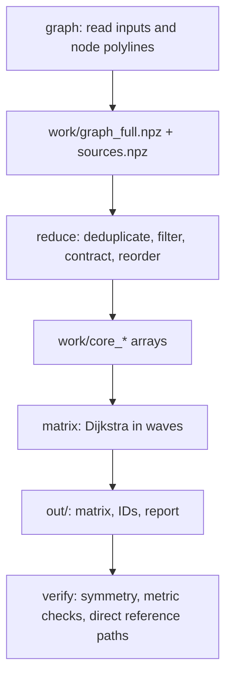

# Running the four-stage pipeline

## Execution plan



| Stage | CLI | Main job | Restart behavior |
| --- | --- | --- | --- |
| 1 | `python run.py graph` | Read shapefiles, build weighted road/ferry graph, attach localities | Rebuilds stage-1 files |
| 2 | `python run.py reduce` | Remove irrelevant components, contract graph, reorder CSR | Auto-resumes compatible atomic checkpoints |
| 3 | `python run.py matrix` | Dijkstra from sources, reexpand to towns, save `.npy` and `.csv` | Auto-resumes row/radius checkpoint if it was computed on the same core graph |
| 4 | `python run.py verify` | Check numerical invariants and compare original graph | Repeats the verification |

`python run.py all` runs these stages sequentially. Each stage records what it
was built from, and the later stages stop with an instruction instead of
mixing files from different runs:

| Situation | Detected by | Result |
| --- | --- | --- |
| A stage-1 setting in `config.py` changed after `graph` | `reduce`, `matrix`, `verify` | Stop: rerun from `graph` |
| Any input shapefile or sidecar changed after `graph` (SHA-256, even with the same size and time) | `reduce`, `matrix`, `verify` | Stop: rerun from `graph` |
| `graph` was rerun but `reduce` was not | `matrix`, `verify` | Stop: rerun `reduce` |
| The matrix checkpoint belongs to another core graph | `matrix` | Checkpoint discarded; rows recomputed |
| `out/` was produced from another core graph or other inputs | `verify` | Stop: rerun `matrix` |

Because the later stages re-read the input shapefiles to compare their hashes,
they need the input folder. `graph` records the folder it read in
`work/sources.npz`, and `reduce`, `matrix` and `verify` reuse it when you do
not pass `--data` (or set `PH_NET_DISTANCE_DATA`). If you moved the inputs,
pass `--data` with the new location; the hashes still decide whether the files
are the same. For a new snapshot, a fresh `--work` and `--out` directory is
still the clearest record.

## Command-line reference

```text
python run.py [all|graph|reduce|matrix|verify]
  [--data DIR] [--work DIR] [--out DIR]
  [--workers N] [--batch N]
  [--waves "1,2"] [--wave-scale F] [--no-partial]
  [--restart-reduce]
```

- `--data` finds the three shapefiles recursively under one directory. More
  than one matching basename fails, preventing accidental mixed vintages.
  If the directory holds `current_transport.json` or `current_boundaries.json`
  (written by the builder scripts), the release they select is used instead.
  Later stages default to the directory recorded by `graph`.
- `--work` stores large intermediate graphs and checkpoints.
- `--out` stores deliverable matrices and reports.
- `--workers 4` uses four worker processes; default is configured as
  `N_WORKERS = 0` meaning CPU count minus one.
- `--batch 8` groups eight sources per Dijkstra call.
- `--waves "1,2"` prioritizes the first two Euclidean neighbor rings.
  `--waves ""` disables limited waves but retains the final full run.
- `--wave-scale 1.5` inflates radius estimates from Euclidean geometry.
- `--no-partial` disables output rewriting at each wave boundary.
- `--restart-reduce` discards the compatible stage-2 checkpoint, not
  the stage-1 source artifacts.

Settings also include `SNAP_DECIMALS`, ferry connectors, the centroid snap
limit, optional endpoint snap offsets, source ordering, the contraction degree
cap, heartbeat intervals, and verification sample sizes. See the commented
`config.py` for the complete set.

## Stage 2: long-running contraction

The reducer writes timestamped heartbeats and progress messages to
`work/reduce_progress.log`. Every
`REDUCE_CHECKPOINT_EVERY_PASSES` completed passes (default 1), it writes an
atomic `work/reduce_checkpoint.npz`. It checks file sizes, timestamps and
relevant reduction parameters before resuming. An interruption mid-pass repeats
that pass; a compatible earlier completed pass remains saved.

```bash
python check_reduce_status.py           # add --work DIR if you used --work
python run.py reduce                    # resume, if checkpoint exists
python run.py reduce --restart-reduce   # start this stage from scratch
```

The contraction checkpoint signature is an **operational resume guard** based
on stage-file metadata and algorithm parameters. In addition, the pipeline now
checks SHA-256 for **every original input shapefile component** against the
manifest embedded in `work/sources.npz`, including after a source file has been
replaced with one of the same size and modification time. The matrix stage
publishes `out/source_manifest.json`. Preserve the upstream source snapshots
and their acquisition provenance for full scientific reproducibility.

## Stage 3: safe partial matrices

Rows are written to a memory-mapped `.npy`. A separate radius array is saved
after matrix data are flushed; after a crash, the checkpoint can safely
recalculate rows rather than wrongly claim completeness. With default settings,
`out/` also receives a labelled partial matrix after each wave; every file in
`out/` is replaced atomically, so an interruption never leaves a truncated
file. Ctrl-C stops the worker processes at once and saves the rows already
finished.

Do not interpret an `inf` entry from an incomplete run as geographic
unreachability. [Output semantics](outputs.md) explains exactly how to tell
these apart.

## Resource use and expected scale

The *historical* input was about 1,642 localities with millions of raw graph
nodes. Reduction accounted for the largest improvement compared with naive
repeated Dijkstra; its performance and memory demands are highly dependent on
network structure, available RAM, storage speed, process count and operating
system. The earlier performance measurements are preserved in
[engineering notes](engineering-notes.md), not advertised as universal speeds.

For your first new full-national run, record RAM and graph cardinalities after
stage 1, run stage 2, and run verification before treating the matrix as
research-grade. National inputs are not included in this repository.
