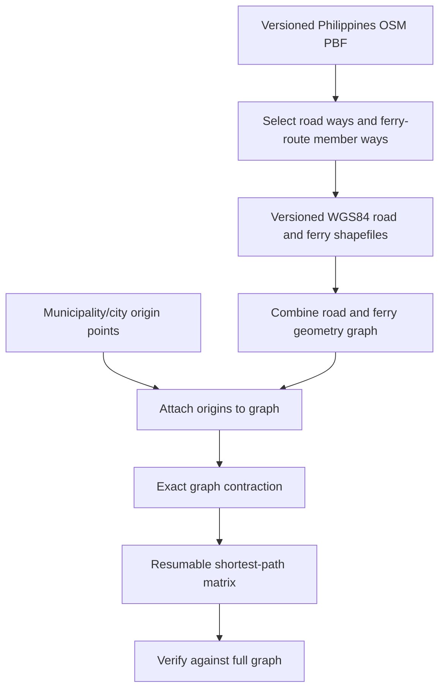

# Building the road and ferry inputs independently

`net-distance-ph` can now **obtain and prepare its own road and ferry geometries** from an OpenStreetMap Philippines extract. The preparation code is optional; users with audited historical shapefiles can still run the original shortest-path engine without rebuilding its sources.

## 1. Source and data rights

The recommended public upstream source is [Geofabrik's Philippines download page](https://download.geofabrik.de/asia/philippines.html), which distributes an OpenStreetMap `.osm.pbf` extract. [OSM's copyright page](https://www.openstreetmap.org/copyright) explains contributor attribution and the Open Database License. The shapefiles generated here are **derived** from OSM and may be subject to the ODbL; do not assume they may be redistributed without meeting the license conditions.

The PBF snapshot is a **moving** product when obtained from a `*-latest` URL. Every build records the actual source file's SHA-256. To reproduce a published matrix, archive the exact downloaded PBF with its hash and date; a later download with the same URL can produce different results. You can enforce an expected fingerprint with `--expected-sha256`.

## 2. Install and acquire

For national PBF extraction, install the optional transport dependencies:

```bash
python -m pip install -e ".[transport]"
python scripts/build_transport.py --download --output data
```

The `--download` switch is explicit: neither `pip install` nor `python run.py graph` downloads OSM data. On subsequent runs, the locally cached PBF is reused. New downloads also save
an `.acquisition.json` sidecar with the actual source URL and HTTP response
metadata. If an older cached PBF lacks that sidecar, its download URL is
reported as **unknown**, rather than mistakenly attributing the file to the
currently requested URL. A cached source acquired from a documented different
URL is refused. The PBF's SHA-256 remains the authoritative source identity.
You can instead prepare a snapshot on another computer or point to a previously downloaded file:

```bash
python scripts/build_transport.py --pbf "data/sources/philippines-latest.osm.pbf" --output data
```

For a fresh source file replacing a cached `*-latest` download, archive the existing file and download a new snapshot deliberately. There is no automatic silent refresh. To publish a new derived transport release while preserving the previous release:

```bash
python scripts/build_transport.py --pbf "data/sources/philippines-latest.osm.pbf" --output data --replace
```

`--replace` changes the **selected release pointer**, not the existing versioned release directory. A 64-character SHA-256 can be supplied to prevent accidentally using a different snapshot.

A tiny `.osm` XML fixture is also accepted for testing; this path is not designed for full-country OSM XML data. Processing full-country PBF files requires `pyosmium`, disk space for both the PBF and shapefiles, and enough memory for OSM node location indexing.

## 3. What gets selected

| Output | Default OSM selection | Interpretation |
| --- | --- | --- |
| `primsectertrunk_road.shp` | `highway=trunk`, `primary`, `secondary`, or `tertiary` | The four historical road classes (not all driveable streets) |
| `ferry_route_shape.shp` | Ways tagged `route=ferry`; plus *route* member ways of `type=route` + `route=ferry` relations (see below) | Mapped ferry geometries, not verified live ferry services |

This is a **defined new extraction recipe**, not a claim to reproduce a historical Geofabrik shapefile byte-for-byte. The original shapefile may have used other tag, date, clipping or cleanup criteria.

Road `_link` classes are omitted by default. Use `--include-links` to add `trunk_link`, `primary_link`, `secondary_link` and `tertiary_link` and record the changed graph specification. Residential/service roads, tracks and paths are not included.

**Expressways are not included by default.** Under the Philippine OSM classification, all tolled expressways (NLEX, SLEX, TPLEX, SCTEX, CALAX and others) are tagged `highway=motorway`, so the default network routes along the parallel trunk roads. This matches the four-class historical network. `--include-motorways` adds `motorway` and `motorway_link` (the ramps, without which motorways would not connect to the rest of the network). The output file keeps the name `primsectertrunk_road.shp`; the provenance records the actual class list. Different class choices change connectivity and shortest-path distances.

**Which members of a ferry relation count as the crossing.** A ferry route relation usually lists more than the sea crossing: approach roads, terminal platforms and pier outlines. Each member carries a *role* label, empty for the route line itself and `platform` or `stop` for terminals. A member way is taken as a ferry line only if its role is empty, `forward` or `backward`; it has no `highway` tag; it has no facility tag (`public_transport`, `amenity`, `man_made`, `building`); it is not `area=yes`; and it is not a closed ring. A `highway`-tagged member keeps its road class (or is left out if that class is not selected). The PBF scan prints how many members each excluded role had. Without these rules, a platform polygon became a closed "ferry route" ring with a gangway candidate, and an approach road was moved from the road layer into the ferry layer.

The PBF is scanned twice: first to collect ferry relation member way IDs, then to extract line strings with valid node coordinates. This avoids omitting ferries represented by a route relation rather than a tagged way. Each output way is written as a PolyLine with `OSM_ID` and `OSM_CLASS` attributes. Coordinates remain EPSG:4326; no planar distance is used to weight those lines later.

Ways with fewer than two distinct vertices are skipped and counted. A selected way that references missing node locations causes the build to **fail** with the list of affected way IDs, rather than silently losing a possibly important network connection; the current release is not changed. An empty road extraction always fails. An empty ferry extraction fails unless `--allow-no-ferries` is set for a deliberately terrestrial-only extract.

!!! warning "Only represented connections exist in the computed graph"
    Neither the OSM relation nor the ferry shape implies a ferry that currently operates, a timetable, a permitted road entry point, or a traversable gangway. A ferry polyline's endpoints are *proposed* attachment points. The graph builder can add a short geometric link from an endpoint to nearby road nodes, subject to `FERRY_CONNECT_KM`. Audit these links before citing network accessibility results.

## 4. Transactional, versioned output

Rather than overwriting `.shp`, `.shx`, `.dbf`, `.prj`, and `.cpg` separately, a successful builder creates a **complete immutable release**:

```text
data/
├── sources/
│   └── philippines-latest.osm.pbf
├── current_transport.json              # atomic selection pointer
└── transport_releases/
    └── <release-id>/
        ├── primsectertrunk_road.shp     # plus sidecars and provenance
        ├── ferry_route_shape.shp        # plus sidecars and provenance
        └── transport_provenance.json
```

The `current_transport.json` pointer switches only after *every* file in the new release is written. Old releases remain available for comparison and replication. A failed build does not change the current pointer. `run.py` and `check_setup.py` resolve the selected version automatically; there is no need to copy files to the root of `data/`.

The provenance includes the PBF hash, acquisition information, exact road-class list, route-selection rule, feature counts, coordinate reference system, and shapefile-sidecar hashes.

## 5. How it enters the original engine



The engine continues to treat the network as undirected, with edge weights based on geodesic polyline lengths (and optional ferry penalties). It does **not** model one-way streets, ramps, turn restrictions, route schedules, travel speed, waiting times, or closure dates. Geometric crossings do not necessarily create a junction unless the ways share a node coordinate. A road line and a ferry line that pass near one another may not be connected unless the graph's explicit ferry endpoint attachment creates a connector.

Use the default `SNAP_FALLBACK_TERMINALS_ONLY = False` only when reproducing older output conventions. For a newly justified matrix, consider enabling it in `config.py` to prevent fallback locality attachment to an intermediate point of a passing ferry route. This is a **behavioral choice**, not a harmless optimization: it can change distances.

## 6. Quality assurance before a nationwide matrix

1. Compare PBF extraction counts, input SHA-256, and sidecar hashes against the provenance and expected source vintage.
2. Review known ferry links and terminals; compare map geometry with operating services and terminal data where possible.
3. Inspect isolated graph components, major under-connected islands, missing highway classes, and large centroid-to-network offsets.
4. Confirm graph topology near grade-separated crossings, ferry-terminal approaches and port access roads.
5. Run `python run.py verify` and independently check a stratified sample of shortest routes.
6. Record the code revision, Python dependencies, filtering choices, and all source fingerprints with the final matrix release.

**Validation status:** the XML extraction path, ferry-relation selection, versioned publication, and failure behavior have offline automated tests. When pyosmium is installed (the GIS job in CI installs it), a small fixture is also converted to PBF and run through the real pyosmium path, which must select exactly what the XML path selects. A full national PBF run and its data quality have not been tested; do not claim them verified based only on synthetic tests.
